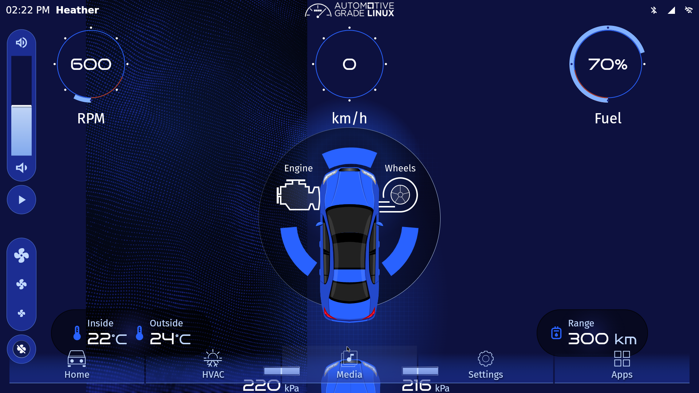

# Ubuntu 26.04でAGLを動かす

インストール直後の **Ubuntu Desktop 26.04 LTS（amd64）→ QEMU/KVM → AGL** で、Flutter IVIデモを起動する手順です。[agl-wsl-demo](https://github.com/e-lab-pius-project/agl-wsl-demo)と同じ固定イメージ・作業用ディスク・CANの扱いを使います。



最初は1〜4節を順に進めてください。SSH・画面設定・リモートデスクトップの詳細は[Ubuntuの初期設定](docs/HOST_SETUP.md)、CANの操作は[CAN接続](docs/USB_CAN.md)と[仮想CAN試験](docs/CAN.md)を参照します。

## 1. 用意するもの

- インストール済みのUbuntu Desktop 26.04 LTS。Ubuntu ServerやWSLは対象外です。
- Intel / AMDのx86-64 CPU。UEFIで仮想化機能（AMD SVM / Intel VT-x）を有効にします。
- インターネット接続とsudo権限のあるUbuntuユーザー。
- 空き容量15 GB以上。QEMUにはRAM 2 GiB・仮想CPU 2個を割り当てます。

Ubuntuのインストールやディスク分割は本書の範囲外です。デュアルブートの場合も、Ubuntuを起動してから作業します。

## 2. Ubuntuを設定する

**Ubuntu本体のデスクトップにログインし、端末を開いて**実行します。

```bash
sudo apt update
sudo apt install -y git
git clone https://github.com/e-lab-pius-project/agl-ubuntu-demo.git
cd agl-ubuntu-demo
bash scripts/setup-host.sh
```

スクリプト全体にはsudoを付けません。必要な箇所だけsudo認証を求めます。

この処理でQEMUなどを導入し、SSHを有効にし、現在のユーザーをkvmグループへ追加します。また、自動ロック・画面の自動消灯・アイドル時の暗転・周囲の明るさに応じた自動調整・無操作時のサスペンドを無効にします。AC接続時とバッテリー駆動時の両方に適用します。無人時も画面が開いたままになるため、実験場所の管理とバッテリー残量に気を付けてください。

一度**ログアウトして、同じユーザーでログインし直します**。再び端末を開き、確認します。

```bash
cd ~/agl-ubuntu-demo
id -nG
ls -l /dev/kvm
test -r /dev/kvm && test -w /dev/kvm && echo 'KVM OK'
echo "$DISPLAY"
```

グループに `kvm`、確認結果に `KVM OK`、DISPLAYに値が出ることを確認します。RDPも使う場合は[デスクトップ共有の設定](docs/HOST_SETUP.md#rdpでデスクトップを共有する)を行ってください。

## 3. AGLのイメージを取得して起動する

**Ubuntuのデスクトップ端末**で実行します。

```bash
cd ~/agl-ubuntu-demo
bash scripts/prepare.sh
bash scripts/start.sh
```

取得先は既存の[agl-wsl-demo Releases](https://github.com/e-lab-pius-project/agl-wsl-demo/releases/tag/agl-20261001)。AGL master snapshot **2026-10-01-b3881 / qemux86-64 / Flutter IVI**を使います。ファイルをSHA-256で照合してから展開します。これはQtデモやInstrument Cluster専用イメージとは異なります。

保存先は `~/agl-qemu` です。元のext4イメージを読み取り専用にし、変更は `agl-work.qcow2` に記録します。`prepare.sh` の再実行で既存の作業用ディスクは消えません。qcow2は元ディスクの絶対パスを参照するため、準備後のデータフォルダーを移動しないでください。

起動したQEMUウィンドウの初回案内ではContinueを押します。起動元の端末は開いたままにします。画面は既存リポジトリと同じ1920×1080の設定です。同じデータフォルダーを使ったQEMUの二重起動は拒否します。

任意の保存先を使う場合は、prepare / start / ssh / CAN試験のすべてで同じ `AGL_DIR` を指定します。

```bash
export AGL_DIR="$HOME/agl-qemu"
```

## 4. AGLへ接続・終了する

**別のUbuntu端末**から接続します。

```bash
cd ~/agl-ubuntu-demo
bash scripts/ssh.sh
```

AGL内は開発用イメージの `root` ユーザーです。初期状態はパスワードなしです。ゲストのSSH転送先はホストの `127.0.0.1:2222` に限定しています。Ubuntuホストへ接続するSSH（ポート22）とは別です。

### 初回の画面が90度回転している場合

公式の未変更イメージでは画面が回転している場合があります。上のSSH接続後、**AGL内**で実行して横向きにします。

```bash
test -e /etc/xdg/weston/weston.ini.original || cp -p /etc/xdg/weston/weston.ini /etc/xdg/weston/weston.ini.original
sed -i 's/transform=rotate-90/transform=normal/g' /etc/xdg/weston/weston.ini
systemctl restart agl-compositor
```

GUIが再起動します。この変更は作業用ディスクに保存されます。続けて、初回案内画面のContinueを押します。

### AGLを終了する

終了するときは、AGL内で `poweroff`、またはUbuntu側から次を実行し、QEMUが終了するまで待ちます。

```bash
bash scripts/ssh.sh poweroff
```

## CANを接続する

- [仮想CANでKUKSAの車速を検査する](docs/CAN.md)
- [USB-CANをAGLへ渡す／Ubuntu側で使う](docs/USB_CAN.md)

既定の仮想 `can0` を残します。AGLが起動して仮想 `can0` ができた後にUSB-CANを渡すと、実アダプターは通常 `can1` になります。名前の衝突を避けるための改名は行いません。起動時から渡す場合は認識順で変わるため、番号だけで物理・仮想を判断しないでください。

## 困ったとき

| 状況 | 確認・対処 |
|---|---|
| `/dev/kvm` がない | UEFIの仮想化設定と `lsmod \| grep kvm` を確認します。 |
| KVMにアクセスできない | `id -nG` でkvmを確認し、ログアウト・ログインします。QEMUをsudoで起動しません。 |
| DISPLAYが空 | Ubuntu本体またはRDPのGNOME端末から起動します。SSH端末だけではGUIを表示できません。 |
| ポート2222を使えない | 別のAGL/QEMUが動いていないか `ss -ltnp 'sport = :2222'` で確認します。 |
| 二重起動のエラー | 同じデータのQEMUが終了したことを確認します。ロックファイル自体を消す必要はありません。 |
| ハッシュ不一致 | 不一致のファイルだけを退避して再取得します。照合を省略しません。 |
| RDP接続できない | [Ubuntu初期設定の確認項目](docs/HOST_SETUP.md)でログイン状態・ポート・ファイアウォールを確認します。 |

## 検証と出典

検証範囲・再現用コマンドは[検証記録](docs/VALIDATION.md)、配布イメージのハッシュと権利関係は[配布物と出典](images/README.md)に記載します。質問や不具合は[Issues](https://github.com/e-lab-pius-project/agl-ubuntu-demo/issues)へ、Ubuntu/QEMUの版とエラーを添えて報告してください。パスワード・秘密鍵は添付しません。

スクリプトとCAN手順は `agl-wsl-demo` の[コミットdcd741d](https://github.com/e-lab-pius-project/agl-wsl-demo/tree/dcd741dda599ef73a9f1135b2df9349552ef120e)を基にしています。AGL公式プロジェクトとは独立した学習用リポジトリです。

用語: ホスト＝Ubuntu本体、ゲスト＝QEMU内のAGL、KVM＝Linuxの仮想化機能、IVI＝ナビ・音楽・空調などの車載情報端末、SocketCAN＝LinuxのCANインターフェース、RDP＝リモートデスクトップの通信方式。
